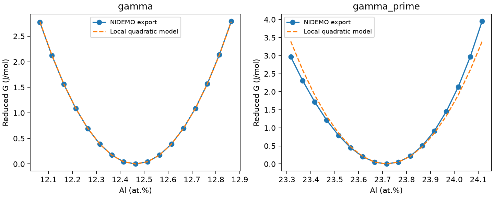
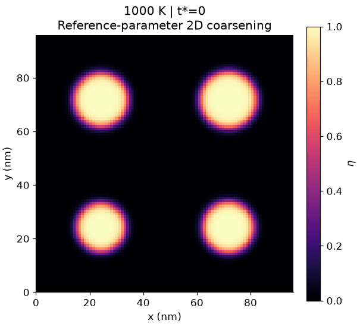
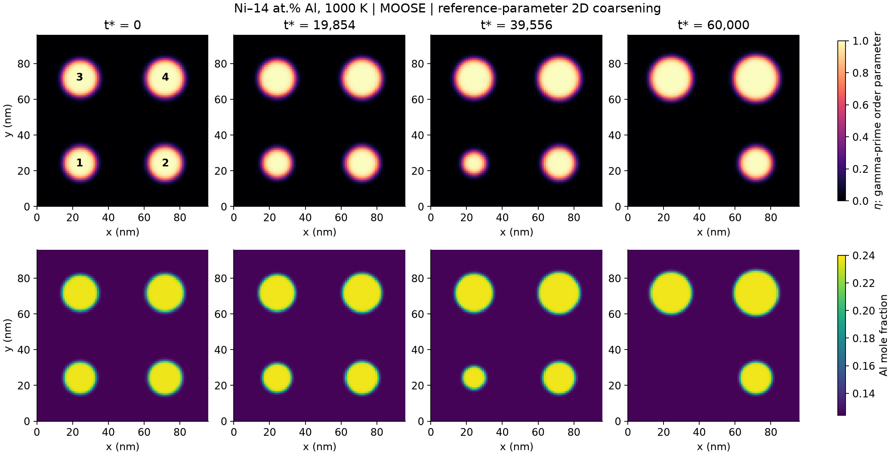
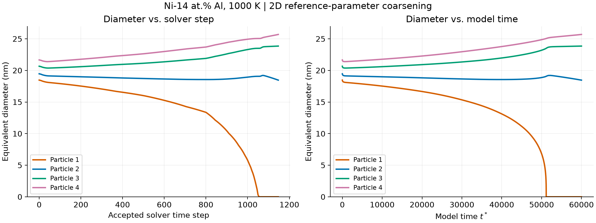

# MOOSE_Calc：Ni–Al γ′颗粒熟化计算

以 **Ni–14 at.% Al、1000 K** 为例，将 Windows 11 中 Thermo-Calc 导出的两相自由能接入 WSL2 中的 MOOSE，计算二维 γ/γ′体系中小颗粒溶解、大颗粒长大的过程。本仓库保存计算环境、热力学输入、MOOSE 输入文件和关键结果。

**结果范围：参考动力学参数下的二维相场演示。** 自由能采用 Thermo-Calc 数据的局部二次近似；扩散系数和界面能尚未实验标定，因此模型时间 `t*` 不等于已经验证的真实时效时间。

## 一、计算环境与部署

### 实际使用的版本

| 组件 | 本次计算版本 / 配置 |
| --- | --- |
| 宿主系统 | Windows 11，x86_64 |
| Linux 计算环境 | WSL2，Ubuntu 24.04.4 LTS |
| WSL 内核 | `6.18.33.2-microsoft-standard-WSL2` |
| MOOSE | 官方预编译包 **2026.10.14**，`mpich` 构建，提交 `c140bfd5a6` |
| PETSc / libMesh | `3.25.4` / `2026.08.18_0772c3d` |
| MPI | MPICH `5.0.1` |
| 环境管理器 | Miniforge3 `26.7.2-0`，安装到 `~/miniforge3-moose` |
| Windows 热力学软件 | **Thermo-Calc Educational 2026b** |
| 热力学数据库 | **NIDEMO 2.0** |
| 热力学计算接口 | Thermo-Calc Console Mode，`.TCM` 宏；本次未使用 TC-Python |
| 参考运行资源 | 4 个 MPI 进程；本机 WSL 可用内存约 15 GiB，swap 4 GiB |

完整 MOOSE 包版本、下载 URL 和 MD5 保存在 [锁定文件](environment/moose-linux-64.lock.txt)，软件运行记录见 [installed-moose.txt](environment/installed-moose.txt)。[moose.yml](environment/moose.yml) 只固定 MOOSE 主包；精确部署使用锁定文件。

### 一键部署 MOOSE 环境

前提：Windows 已安装 Git；WSL2 的 `Ubuntu-24.04` 已完成首次启动和 Linux 用户创建。全新 Windows 可先在管理员 PowerShell 执行 `wsl --install -d Ubuntu-24.04`，按提示重启并完成首次设置，再运行下面的代码块。计算脚本按 Linux x86_64 编写。

在 PowerShell 粘贴执行（目录可改；不要覆盖已有同名项目目录）：

```powershell
$ErrorActionPreference = 'Stop'
$project = Join-Path $HOME 'MOOSE_Calc'
if (Test-Path -LiteralPath $project) { throw "目录已存在：$project；请换一个目录，或进入已有仓库运行部署脚本。" }
git clone https://github.com/NortonLynch/MOOSE_Calc.git $project
if ($LASTEXITCODE -ne 0) { throw 'Git clone 失败' }
wsl.exe -d Ubuntu-24.04 --cd $project -- bash scripts/install_wsl.sh
if ($LASTEXITCODE -ne 0) { throw 'MOOSE 部署或输入检查失败' }
```

已有仓库时，在项目根目录运行：

```powershell
wsl.exe -d Ubuntu-24.04 --cd (Get-Location).Path -- bash scripts/install_wsl.sh
```

[部署脚本](scripts/install_wsl.sh) 自动下载固定版本的 Miniforge、核验 SHA256、根据锁定文件创建 `moose` 环境，并检查版本和测试输入语法。已有环境会保留；若核心版本不符会报错。首次部署需要网络，且依赖对应软件包仍可从源站下载。脚本不覆盖锁定文件。

Thermo-Calc 需从[官方教育版页面](https://thermocalc.com/academia/free-educational-package/)取得 **2026b** 安装程序，在 Windows 中完成安装与许可步骤，并确认 NIDEMO 2.0 可用。此步骤需使用者完成，以上代码块只自动部署 MOOSE。使用仓库中已导出的自由能和主输入重算 MOOSE 时，无需运行 Thermo-Calc。安装方式参考 [MOOSE 官方预编译安装说明](https://mooseframework.inl.gov/moose/getting_started/installation/moose_conda_binary.html)与 [Miniforge 固定版本发布页](https://github.com/conda-forge/miniforge/releases/tag/26.7.2-0)。

## 二、计算输入

### Thermo-Calc 自由能

条件为 `T=1000 K`、`P=101325 Pa`、`x_Al=0.14`。所有成分均为原子/摩尔分数，能量单位为 J/mol。

| 文件 | 内容 |
| --- | --- |
| [gamma_1000K.csv](thermodynamics/ni_al_1000K/gamma_1000K.csv) | 无序 γ 单相自由能、化学势、导数与摩尔体积；502 点 |
| [gamma_prime_1000K.csv](thermodynamics/ni_al_1000K/gamma_prime_1000K.csv) | 有序 γ′单相自由能及有序性检查；242 点 |
| [equilibrium_target_1000K_xAl014.csv](thermodynamics/ni_al_1000K/equilibrium_target_1000K_xAl014.csv) | 目标成分下的两相平衡 |
| [宏文件](thermodynamics/macros/) / [原始文本输出](thermodynamics/raw/) | 可追溯的 Console Mode 输入与原始数值输出 |
| [metadata.json](thermodynamics/ni_al_1000K/metadata.json) / [数据说明](thermodynamics/ni_al_1000K/README.md) | 软件及数据库版本、单位、参考态、校验与重算顺序 |

两相平衡 Al 分数分别为 **0.124644（γ）**、**0.237162（γ′）**，体相平衡 γ′体积分数约 **13.8609%**。MOOSE 使用减去共同公切线后的局部二次自由能：

```text
Gγ(cγ)   = 0.5 × 347973.0 × (cγ − 0.124644)²   [J/mol]
Gγ′(cγ′) = 0.5 × 424347.4 × (cγ′ − 0.237162)²  [J/mol]
```

曲率由各平衡点附近 `±0.00101` 的成分窗口拟合；两条单相自由能通过解析消元的 KKS 约束耦合。**完整相平衡自由能包络不能代替两条单相自由能。** 共同摩尔体积取 `7.0×10⁻⁶ m³/mol`。拟合与原始数据对比如下：



### MOOSE 输入脚本

主输入：[examples/ni_al_coarsening/coarsening.i](examples/ni_al_coarsening/coarsening.i)。方程、无量纲化和适用边界见 [MODEL.md](examples/ni_al_coarsening/MODEL.md)，参数见 [model_parameters.json](results/ni_al_coarsening/model_parameters.json)。

| 项目 | 设置 |
| --- | --- |
| 计算域 / 网格 | 96×96 nm²，96×96 个 Q1 四边形，双向周期边界 |
| 初始颗粒半径 | 9.2、9.7、10.3、10.8 nm |
| 求解变量 | Al 浓度 `c`、相场 `eta`、扩散势 `mu` |
| 演化方程 | 守恒扩散与 Allen–Cahn 界面演化 |
| 参考界面能 / 界面宽度 | 0.020 J/m² / 4 nm（η=0.1–0.9） |
| 参考扩散系数 | `1×10⁻¹⁸ m²/s`，未从迁移率数据库标定 |
| 求解 | 隐式 Euler，Newton + MUMPS，自适应时间步 |
| 终止时间 / 场输出 | `t*=60000`；通常每 5 个接受步保存场，并保存最终状态 |

在项目根目录运行，新结果使用 `rerun` 名称：

```powershell
# 检查主输入
.\scripts\run_moose.ps1 -InputFile examples/ni_al_coarsening/coarsening.i -ExtraArgs '--check-input'

# 使用 4 个 MPI 进程计算；日志写入 logs/ni_al_coarsening.log
wsl.exe -d Ubuntu-24.04 --cd (Get-Location).Path -- bash scripts/run_ni_al_coarsening.sh 4 Outputs/file_base=results/ni_al_coarsening/rerun
```

Thermo-Calc 宏内保留了原始计算路径 `D:/MOOSEcalc`；在其他位置重新导出时，先复制宏并统一修改输出及读取路径，执行顺序见[热力学说明](thermodynamics/ni_al_1000K/README.md)。MOOSE 主输入已包含自由能表达式，可直接计算。

## 三、计算输出与重点结果

### 熟化动画与组织演化





### 颗粒直径随时间步变化



左图横轴为**求解器接受的时间步编号**（初始状态为 0），右图为自适应步长对应的模型时间 `t*`。数据来自 231 个保存帧，逐帧匹配已去除恢复废弃分支的求解记录；最终为 **1147 个接受时间步**，不将保存帧编号当作求解步数。曲线连接保存帧测量值。

等效直径定义为 `d = 2√(∫h(η)dA/π)`，在四个初始颗粒各自所在象限积分；这是二维等效面积直径。颗粒编号与上方组织快照一致。

| 颗粒 | 初始直径 / nm | 最终直径 / nm | 变化 |
| --- | ---: | ---: | --- |
| 1，左下 | 18.47 | ≈0 | 溶解 |
| 2，右下 | 19.47 | 18.46 | 净收缩 |
| 3，左上 | 20.66 | 23.85 | 长大 |
| 4，右上 | 21.66 | 25.69 | 长大 |

最小颗粒首次在第 **1040** 个接受步的保存帧中不再具有 `η≥0.5` 区域（`t*≈51141.63`）；最终颗粒数从 4 降为 3。此消失判据不等同于平滑面积积分严格为零，时间精度受输出间隔限制。

### 数值一致性与数据下载

总体 Al 分数保持 0.14，最大积分偏差 **1.47×10⁻¹⁴**；总约化自由能从 **35.91768** 降至 **30.24406**，接受步中未出现能量上升。

| 结果 | 文件 |
| --- | --- |
| 直径—求解步数—模型时间数据 | [particle_diameter_vs_step.csv](results/ni_al_coarsening/particle_diameter_vs_step.csv) |
| 直径统计、时间匹配精度和源文件哈希 | [diameter_summary.json](results/ni_al_coarsening/diameter_summary.json) |
| 原始粒径、颗粒数、区域 Al 积分 | [particle_history.csv](results/ni_al_coarsening/particle_history.csv) |
| 接受步能量和守恒记录 | [diagnostics.csv](results/ni_al_coarsening/diagnostics.csv) / [图](results/ni_al_coarsening/diagnostics.png) |
| 基体扩散势和通量方向 | [diffusion_evidence.png](results/ni_al_coarsening/diffusion_evidence.png) |
| 完整结果说明和数值校验 | [RESULTS.md](results/ni_al_coarsening/RESULTS.md) / [validation.json](results/ni_al_coarsening/validation.json) |

完整 Exodus 场文件 `coarsening.e`（139,242,316 字节）及检查点保留于原计算机器，**不包含在本 Git 仓库中**；可通过主输入重新生成场文件。仓库包含关键图像、数据表、原始追加式 CSV 及 [Exodus SHA256](results/ni_al_coarsening/exodus_sha256.json)。本次曾从检查点恢复并调整步长控制；干净重算不保证逐步轨迹与已发布结果完全相同。

该算例没有加入相干弹性、晶向和三维几何，也未完成网格、时间步与界面宽度的系统收敛验证。结果支持参考参数下的熟化现象，不能直接用于预测实验时效小时数或三维熟化速率。
