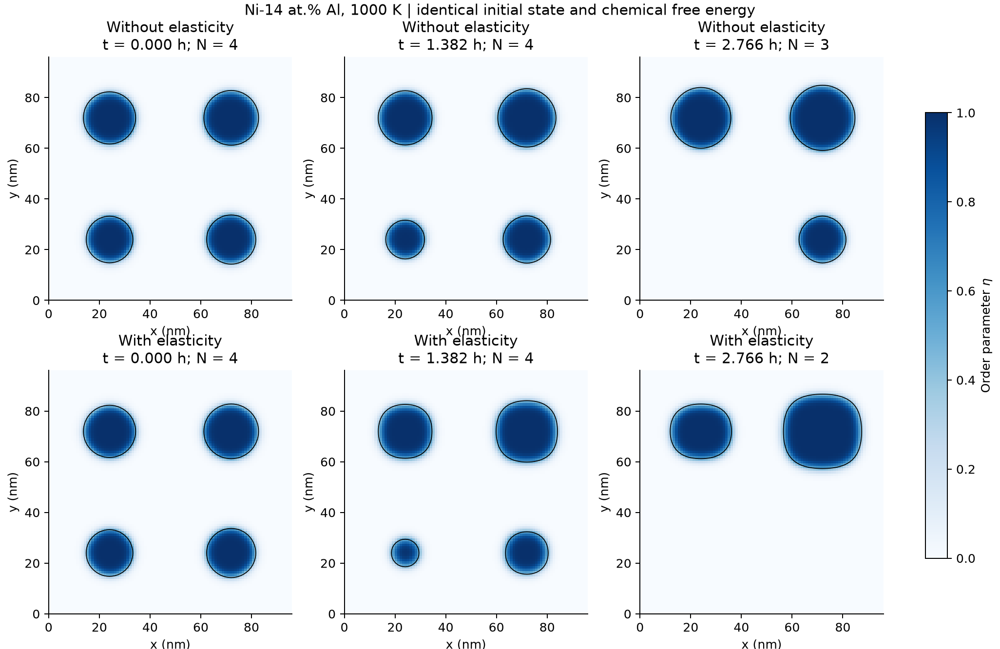
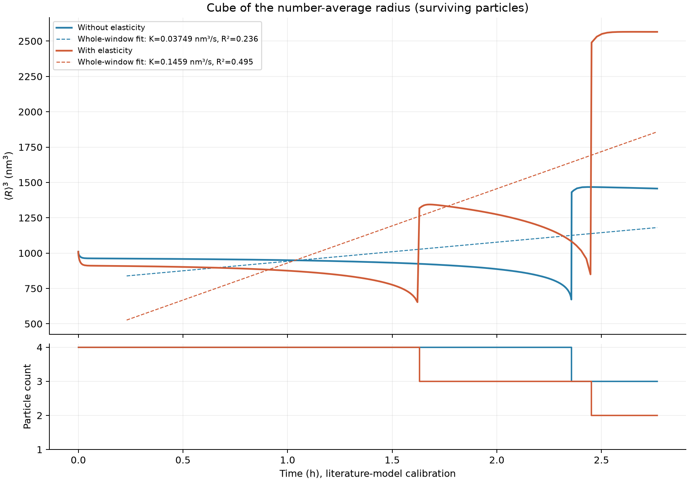

# Ni–Al 弹性熟化对比结果

两组均已完成 `t*=60000`。有弹性模型在原查表算例上加入附件的 γ/γ′立方弹性与 0.0047 共格失配，其他物理参数和初始相场保持相同。

完整图表、参数、回归窗口、时间公式及文献出处见 [REPORT.html](REPORT.html)。

**实验资料：** [Ni–Al 实验熟化率汇总与原文核查](experimental_benchmarks/REPORT.html)
及 [可复用数据表](experimental_benchmarks/experimental_rates.csv)。最接近 1000 K 的已核实
原作者数据为约 988 K 的 `0.0701 nm³/s` 和约 1023 K 的 `0.160 nm³/s`，
统计量是平均立方体半边长的三次方；成分与温度未精确匹配本算例，也不是 P4 单颗粒速率。

**追加：固定大颗粒 P4 的三次方增长。** 按后续要求重新提取同一 P4 的面积，输出
`A^(3/2)` 和 `r_P4^3` 随物理时间变化。见 [单颗粒报告](single_particle/REPORT.html)
及 [单颗粒曲线](single_particle/P4_radius_cubed_vs_time.png)。在 `t*=5000–30000`，
无弹性/有弹性单颗粒斜率为 `0.0615759 / 0.1668253 nm³/s`，R² 为 `0.9890 / 0.9708`。
在 `t*=5000–60000`，斜率为 `0.0993260 / 0.3281705 nm³/s`，R² 为 `0.9661 / 0.9616`。
局部可以近似直线，全程斜率依赖时间窗口；下文保留的全体平均值属于另一统计量。

| 终态指标 | 无弹性 | 有弹性 |
| --- | ---: | ---: |
| 剩余颗粒数 | 3 | 2 |
| 数平均半径 / nm | 11.33576 | 13.68918 |
| 数平均半径立方 / nm³ | 1456.638 | 2565.268 |
| P4（初始最大颗粒）的终态半径 / nm | 12.84423 | 15.63858 |
| P1 消失时间 / h | 2.356–2.358 | 1.621–1.630 |

物理时间采用文献 fcc 迁移率与当前 NIDEMO 热力学因子组合：
`Dchem=6.0247332e-18 m²/s`，`1 t*=0.16598177 s`；终点为 **9958.906 s / 2.766363 h**。
这是有来源的模型时间，尚未用 1000 K 的实验时效数据验证。

## ParaView

大型场文件发布在 [ni-al-elastic-v1 Release](https://github.com/NortonLynch/MOOSE_Calc/releases/tag/ni-al-elastic-v1)，不存入 Git 历史。在克隆后的项目根目录运行（Python 3.9+，仅标准库）：

```bash
python scripts/download_elastic_results.py
```

下载器按照 [release_manifest.json](release_manifest.json) 核查压缩包及每个文件的 SHA256，恢复两份物理时间场、原始弹性场、初始稳态场、零失配场，以及无弹性 `results/ni_al_lookup/lookup.e`。遇到内容不同的已有文件会停止，避免覆盖本地重算结果。也可手动下载 ZIP 并在仓库根目录解压。论文原文仅保留公开来源链接与核查记录，不随本 Release 分发。

打开 [有弹性 elastic_seconds.e](elastic_seconds.e) 或 [无弹性 no_elastic_seconds.e](no_elastic_seconds.e)，勾选变量并 Apply。
按 `eta` 着色查看析出相，按 `stress_xx_MPa` 等查看弹性应力。
时间为秒，坐标/位移波动为 nm，应力为 MPa，能量密度为 J/m³。
二维积分能量为每单位面外厚度的 J/m。位移仅包含周期波动部分，均匀全局应变未加到位移输出中。

物理时间副本保留原 c/eta/mu 节点场；第零帧机械辅助输出按初始独立稳态解修正，原因和逐点校验见报告及 [control_validation.json](control_validation.json)。原始 MOOSE 场文件保留。

## 曲线和拟合





主统计量是 **⟨r⟩³，不是 ⟨r³⟩**。在 `t*=5000–60000` 的同一窗口，时间加权有效斜率分别为 `0.037492` 和 `0.145905 nm³/s`，R² 分别为 `0.2364` 和 `0.4949`。
曲线有颗粒消失引起的跳变，固定颗粒数时也存在平均半径下降；本次结果没有验证稳定的 LSW 线性粗化，不能把这些有效斜率当作材料粗化常数。
所有预定义窗口和固定颗粒数区间均保留在 [coarsening_rate_fits.csv](coarsening_rate_fits.csv)。

- [弹性颗粒历史](elastic_particle_history.csv) / [无弹性颗粒历史](no_elastic_particle_history.csv)：各颗粒等面积半径、颗粒数、两种三阶统计量、秒与小时。
- [对比动画](elastic_comparison.gif)、[应力图](elastic_stress_final.png)、[守恒与能量图](conservation_energy_fraction.png)。
- [时间换算参数](time_calibration.json)、[计算指标](comparison_metrics.json)、[Exodus 单位与 SHA256](physical_exodus_manifest.json)。
- [模型与一键重算说明](../../examples/ni_al_elastic/README.md)。

检查通过：零失配退化对照、初始节点场一致性、总 Al 守恒、总自由能非增和面内平均应力残差。它们不代替网格/时间步收敛研究。
