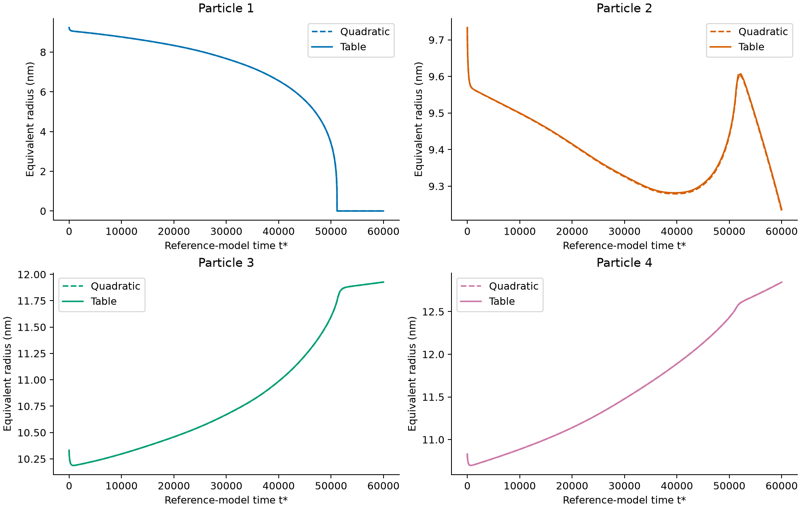
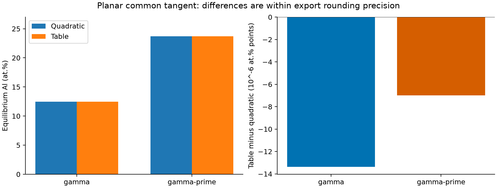
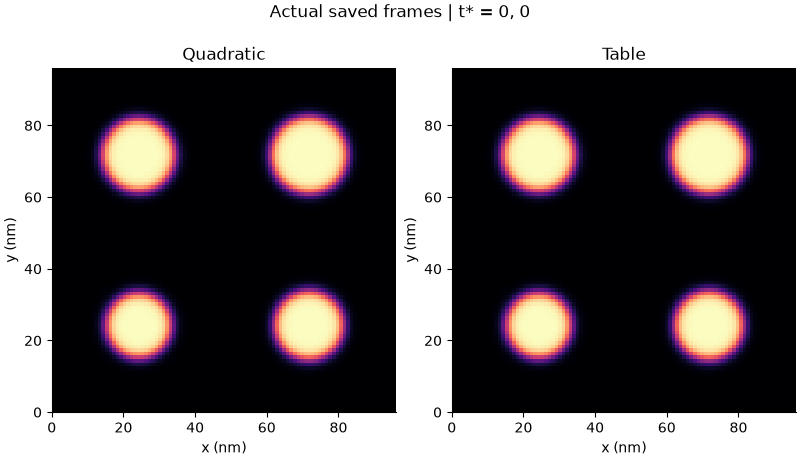

# Ni–Al 查表自由能与二次近似对照结果

固定 **Ni–14 at.% Al、1000 K、γ/γ′**，沿用原算例的几何、初始场、网格、界面参数、迁移率和参考尺度。唯一物理输入变化是单相自由能的表示：将局部二次近似替换为 Thermo-Calc 原始 502/242 点数据的分段三次 Hermite 插值，能量及其导数使用同一表达式。两相共同扣除同一仿射参考态。

## 主要结论

| 指标 | 二次近似 | 查表法 |
| --- | ---: | ---: |
| γ 平衡 Al / at.% | 12.464400 | 12.464387 |
| γ′平衡 Al / at.% | 23.716200 | 23.716193 |
| P4 有效半径增长率，`t*=5000–30000` / nm·`t*⁻¹` | 2.7676691×10⁻⁵ | 2.7628320×10⁻⁵ |
| P4 最终等效半径 / nm | 12.846351 | 12.844226 |
| 最终颗粒数 | 3 | 3 |
| 场数据保存帧数 | 233 | 233 |
| 终止模型时间 `t*` | 60000 | 60000 |

平衡成分差异处于原始导出数据的有效精度内。最大颗粒 P4 的半径增长率在两个窗口 `5000–30000` 和 `10000–40000` 分别变化 **−0.1748%** 和 **−0.1107%**；前一窗口的 `R³` 斜率变化约 **−0.1753%**。这些是四颗粒二维算例的有效拟合斜率，不是三维 LSW 常数。

两个拟合窗口采用完全一致的接受时间网格。最小颗粒溶解附近，查表计算额外细分了 10 步；二次对照的重算尾段又细分了 2 步，因此不能声称全过程的接受时间网格一致。末态差异需结合这个时间离散限制理解；尾段加密对二次对照最终半径的影响小于 `9×10⁻⁷ nm`。

两种计算的总体 Al 分数保持为 0.14，保存场积分的最大偏差均为 `2.78×10⁻¹⁷`，接受步未出现总约化自由能上升。核查状态为 `PASS`，见 [comparison_metrics.json](comparison_metrics.json)。原算例场文件 SHA256 保持不变。







## 报告、数据与 ParaView

- [完整中文 HTML 报告](REPORT.html)：自包含 7 张对比图。GitHub 不直接渲染 HTML，请下载后用浏览器打开。
- [对比统计表](comparison_summary.csv)、[查表颗粒轨迹](lookup_particle_history.csv)、[二次对照颗粒轨迹](quadratic_control_particle_history.csv)。后者使用最终 `quadratic_matched.e`，保留旧键名便于分析脚本兼容。
- 图像同时提供 PNG 和矢量 PDF，包括自由能、平衡成分、相内成分、粒径、增长率、能量及组织对比。
- [GitHub Release：ni-al-lookup-v1](https://github.com/NortonLynch/MOOSE_Calc/releases/tag/ni-al-lookup-v1)。下载 `ni_al_lookup_results.zip` 后解压到仓库根目录，压缩包已包含 `results/` 目录结构。也可运行下面的校验下载命令。

```bash
# 项目根目录，任意 Python 3.9+；只使用标准库
python scripts/download_lookup_results.py
```

下载工具核验 [release_manifest.json](release_manifest.json) 中的压缩包和逐文件 SHA256，遇到不同内容的本地同名文件会停止，已一致的文件会跳过。归档包含报告、图像、CSV/JSON 和下列原始场数据；不包含软件安装包、许可证、缓存或中途失败结果。

| 场文件 | 用途 |
| --- | --- |
| `results/ni_al_lookup/lookup.e` | 查表法完整模拟，ParaView 主结果 |
| `results/ni_al_lookup/quadratic_matched.e` | 最终二次对照，ParaView 主结果 |
| `results/ni_al_lookup/quadratic_control.e` | 原时间网格上的完整嵌套 KKS 二次计算 |
| `results/ni_al_lookup/quadratic_analytic_tail.e` | 新鲜 SolutionIC 重启计算的尾段，用于审计拼接来源 |
| `results/ni_al_lookup/control_smoke.e` | 短算例的代数消元/嵌套 KKS 一致性验证 |
| `results/ni_al_coarsening/coarsening.e` | 原始二次算例，分析与时间网格参考 |

ParaView 中分别打开 `lookup.e` 和 `quadratic_matched.e`，选择 `ExodusIIReader` 并 Apply；按 `eta` 查看析出相、按 `c` 查看总体 Al 浓度。`c_gamma` 和 `c_gamma_prime` 是单元平均值，`c`、`eta`、`mu` 是节点值。

## 复现与解释边界

环境与完整执行步骤见[查表算例说明](../../examples/ni_al_lookup/README.md)。入口为 `bash scripts/run_lookup_comparison.sh`，输出到新的带时间戳目录。下载场文件后，可用 `python scripts/analyze_lookup_comparison.py` 重新生成本次报告与图像。

`quadratic_matched.e` 来自 `quadratic_control.e` 的原始前段与实际重新求解的尾段；未插值或修改场值，连接处 `c/eta/mu` 最大差为零，见 [assembled_control.json](assembled_control.json)。能量采用 C¹ 连续的 Hermite 插值，二阶导数在节点间分段连续；尚未验证更密热力学表带来的变化。

界面能和迁移率使用参考参数，模型未加入相干弹性、三维几何，也未完成系统的网格/时间步/界面宽度收敛分析。因此小于 0.2% 的差别仅描述本算例，不代表实验预测精度或查表法的普遍优势。
